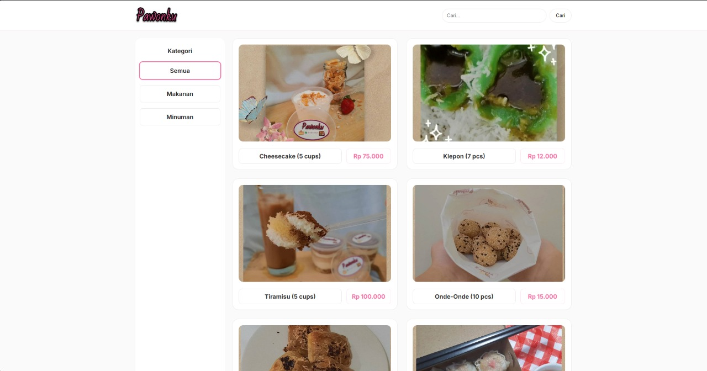

# Pawonku Web

Katalog menu makanan dan dashboard admin berbasis PHP dan MySQL. Pengunjung melihat daftar menu, admin mengelola produk lewat dashboard.



## Isi repositori

```text
preview.jpeg        tangkapan layar
pawonku_web/        aplikasi PHP
├── config.php      koneksi PDO, helper e() dan rupiah()
├── pawonku.sql     skema dan data contoh
├── public/         halaman publik: index.php, _header.php, _footer.php
├── admin/          login.php, index.php, product_form.php, delete.php, logout.php
├── assets/         logo dan stylesheet
└── uploads/        gambar produk hasil unggahan admin
```

Aplikasinya ada di dalam folder `pawonku_web`, bukan di root repositori. Dokumentasi versi ringkas untuk folder itu ada di `pawonku_web/README.md`.

## Kebutuhan

- PHP 8 dengan ekstensi PDO MySQL
- MySQL atau MariaDB (XAMPP, Laragon, atau setara)
- Web server dengan document root mengarah ke folder aplikasi

## Instalasi

1. Buat database `pawonku`, lalu impor `pawonku_web/pawonku.sql` lewat phpMyAdmin.
2. Salin folder `pawonku_web` ke document root, misalnya `C:\xampp\htdocs\pawonku_web`.
3. Sesuaikan `pawonku_web/config.php`. Nilai bawaan adalah `DB_NAME=pawonku`, `DB_USER=root`, `DB_PASS` kosong, dan `$BASE_URL` diatur ke `/PAWONKU_WEB`. Ubah `$BASE_URL` jika nama foldernya berbeda.
4. Pastikan folder `uploads` bisa ditulis oleh web server.
5. Buka `http://localhost/pawonku_web/`.

## Halaman admin

| Halaman | Fungsi |
|---|---|
| `admin/login.php` | masuk dengan akun dari tabel `admins` |
| `admin/index.php` | daftar produk dan ringkasan |
| `admin/product_form.php` | tambah dan ubah produk, termasuk unggah gambar |
| `admin/delete.php` | hapus produk |
| `admin/logout.php` | keluar dari sesi admin |

## Struktur data

Skema lengkap ada di `pawonku_web/pawonku.sql`. Dua tabel utama:

- `admins`: `username`, `password_hash` (bcrypt), `is_active`.
- `products`: `name`, `category` (enum `makanan` atau `minuman`), `price`, `image`, `is_active`.

## Catatan

- `config.php` memakai kredensial pengembangan lokal dan nilainya ikut ter-commit. Ganti sebelum dipakai di server publik.
- `pawonku.sql` ikut membawa akun admin contoh berupa hash bcrypt. Ganti password atau hapus akun contoh itu setelah instalasi.
- `$BASE_URL` masih hardcoded, jadi aplikasi tidak otomatis menyesuaikan diri kalau nama foldernya diubah.
